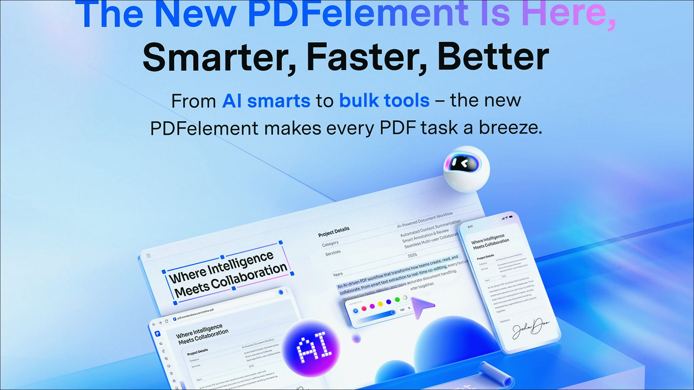

# Wondershare PDFelement 13.0 v13.0.7 for Windows — MoggyDay

**Language / Язык:** the [GitHub Pages site](https://quickoechannel.github.io/wondershare-pdfelement-windows/) picks English or Russian from the browser. Switch: [English](https://quickoechannel.github.io/wondershare-pdfelement-windows/?lang=en) · [Русский](https://quickoechannel.github.io/wondershare-pdfelement-windows/?lang=ru)

Wondershare PDFelement · MoggyDay · 13.0 · v13.0.7

# Wondershare PDFelement 13.0 “for Windows: PDF edit, OCR, Office export” [v13.0.7]

  
  
  

MoggyDay keeps one stable URL for Wondershare PDFelement: EN / RU. Edit PDF and OCR. Russian UI, 221 MB, Windows x64.

## Download

1. Open [Wondershare PDFelement EN](https://moggydayprogram.com/en/programs/wondershare-pdfelement) or [Wondershare PDFelement RU](https://moggydayprogram.com/programs/wondershare-pdfelement).
2. Stay on moggydayprogram.com.
3. Use the primary button on that card. Prefer [MoggyDay Launcher](https://moggydayprogram.com/launcher) if the archive is large.
4. After a catalog update, reload the same program URL.

## Official links

| | URL |
| --- | --- |
| EN | https://moggydayprogram.com/en/programs/wondershare-pdfelement |
| RU | https://moggydayprogram.com/programs/wondershare-pdfelement |
| Hub | https://moggydayprogram.com/categories/office |
| Category | https://moggydayprogram.com/categories/office |
| Catalog | https://moggydayprogram.com/programs |
| Launcher | https://moggydayprogram.com/launcher |

## More programs on MoggyDay

- [CCleaner](https://moggydayprogram.com/programs/ccleaner)
- [FastStone Capture](https://moggydayprogram.com/programs/faststone-capture)
- [Download Master](https://moggydayprogram.com/programs/download-master)
- [Camtasia](https://moggydayprogram.com/programs/camtasia)

Canonical: https://moggydayprogram.com/programs/wondershare-pdfelement  
GitHub Pages: https://quickoechannel.github.io/wondershare-pdfelement-windows/  
No installer on this repo — packages live on the catalog site.
